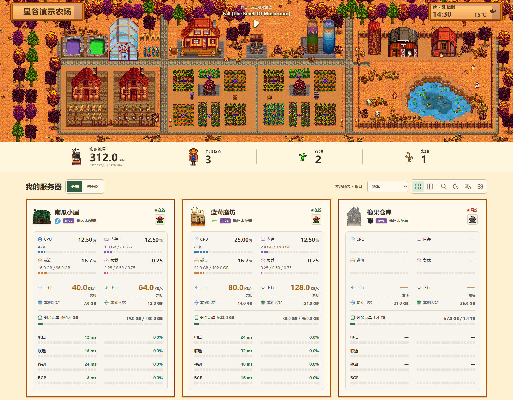

# 星谷哨站 🌾

星谷哨站是一款《星露谷物语》风格的 CF-Server-Monitor 服务器监控主题。每台服务器对应一间像素小屋，农场随四季、昼夜和当地天气变化，入夜后在线节点会亮起窗灯。

农场下方就是监控面板。用卡片看一台机器的 CPU、内存和网络流量，用列表比较多台服务器，点节点名称可以查看历史曲线。电脑和手机都能使用。

## 安装与试用

准备一个已部署的 CF-Server-Monitor 站点，并使用管理员账号登录。还没有站点的话，可以先看上游的部署说明。[CF-Server-Monitor 项目](https://github.com/huilang-me/CF-Server-Monitor)

**自定义主题 URL（已测试的固定版本）**

```text
https://github.com/howbit/stardew-monitor/tree/298c90074fed3d037c10ee7f6d7b578df4633f43
```

1. 打开自己站点的管理后台，进入 **主题商店**。
2. 将上面一整行地址复制到 **自定义主题 URL**，点击 **预览**。
3. 在预览页查看自己的节点，再点开一个节点名称，确认详情和监控数据正常显示。
4. 喜欢这个效果，就回到主题商店，点击 **应用自定义**。访客此时会在首页看到农场主题。以后想切回去，在同一处点击 **使用内置主题** 即可。

### 开启实况天气

1. 打开 CF-Server-Monitor **管理后台 → 设置**，在 **外观** 区域找到 **CSP API 域名白名单**。
2. 在原有内容末尾追加 `https://api.open-meteo.com`，用于读取当地天气和气温。每个地址只填到域名，多个地址之间用英文逗号 `,` 分隔。
3. 如果还希望在设备定位不可用时按访客 IP 估算城市，再追加 `https://get.geojs.io`。下方这行可以直接复制，同时启用天气和 IP 定位。

   ```text
   https://api.open-meteo.com,https://get.geojs.io
   ```

4. 点击 **保存配置**，刷新首页，将季节选为 **自动（天时联动）**。有可用坐标时，把鼠标移到右上角天气图标上，提示中出现 **实况** 和 **Open-Meteo** 就表示已取到天气数据。手动选择季节时，天气牌显示 **模拟**，方便预览当季场景。

## 白天和夜晚

两张秋季首页截图里的南瓜小屋、蓝莓磨坊和橡果仓库都是虚构节点。截图中的在线状态、配置和监控读数均为演示数据。安装后，面板会显示你自己站点的数据。

**秋日 · 14:30**　可以看到池塘、牧场和两片秋收的田地。农场下方的节点卡片会列出实时速率、流量配额、线路延迟和丢包率。



**秋夜 · 20:30**　同一座农场亮起窗灯，卡片随之切换到深色，曲目也从 *The Smell of Mushroom* 换成 *Raven’s Descent*。


## 装好后，试试传送到另一座农场

点在线节点卡片右侧的 **传送按钮**。如果节点已配置时区和坐标，农场会跟随那里的季节、当地时间和天气。选一个和你有时差的节点，有时正好能从白天走进夜里。点 **返回本地农场** 就能回来。

想一次看遍四季，可以用季节菜单选春、夏、秋、冬，再点太阳或月亮切换昼夜。配乐会随场景切换。想安静看数据，点一下暂停，刷新页面或切换季节都会保留暂停状态。
