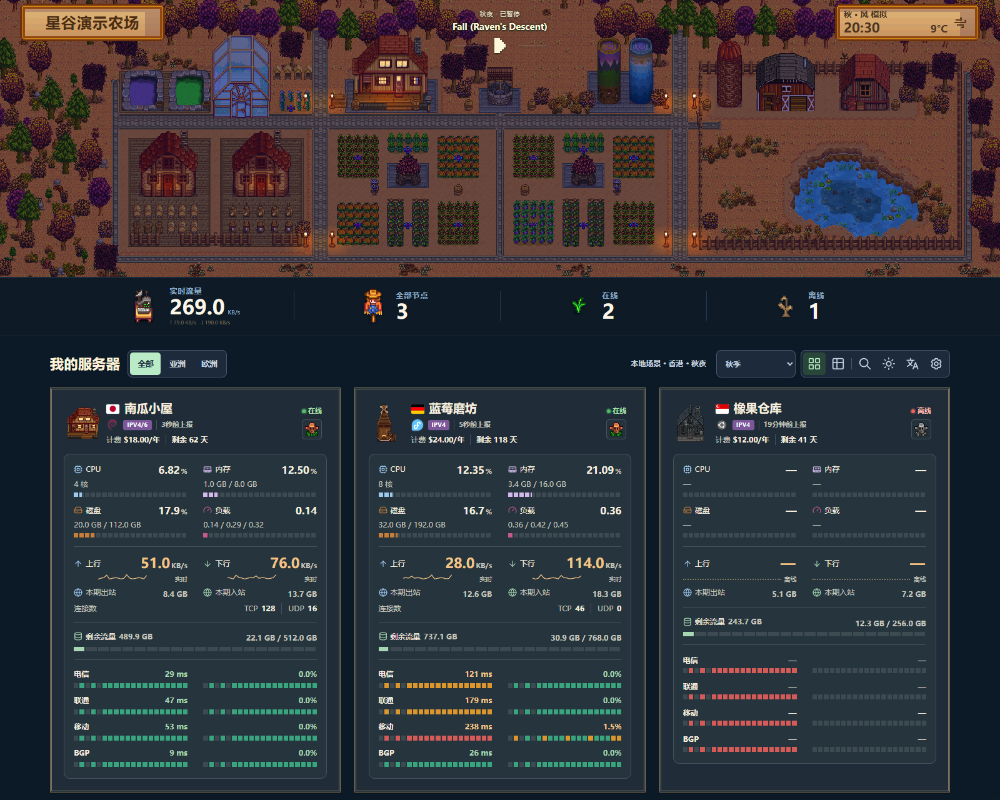

# 星谷哨站 🌾

星谷哨站是一款《星露谷物语》风格的 CF-Server-Monitor 服务器监控主题。每台服务器对应一间像素小屋，农场随四季、昼夜和当地天气变化，入夜后在线节点会亮起窗灯。

农场下方就是监控面板。用卡片看一台机器的 CPU、内存和网络流量，用列表比较多台服务器，点节点名称可以查看历史曲线。电脑和手机都能使用。

## 安装与试用

准备一个已部署的 CF-Server-Monitor 站点，并使用管理员账号登录。还没有站点的话，可以先看上游的部署说明。[CF-Server-Monitor 项目](https://github.com/huilang-me/CF-Server-Monitor)

**自定义主题 URL**

```text
https://github.com/howbit/stardew-monitor/tree/dist
```

1. 打开自己站点的管理后台，进入 **主题商店**。
2. 将上面一整行地址复制到 **自定义主题 URL**，点击 **预览**。
3. 在预览页查看自己的节点，再点开一个节点名称，确认详情和监控数据正常显示。
4. 喜欢这个效果，就回到主题商店，点击 **应用自定义**。访客此时会在首页看到农场主题。以后想切回去，在同一处点击 **使用内置主题** 即可。

如果希望固定使用某次构建，可以在 `dist` 的提交记录里选一个提交，把地址中的 `dist` 换成该提交的完整 SHA。选择固定版本后，后续构建不会自动切换已安装的主题。

### 开启实况天气

1. 打开 CF-Server-Monitor **管理后台 → 设置**，在 **外观** 区域找到 **CSP API 域名白名单**。
2. 在原有内容末尾追加 `https://api.open-meteo.com`，用于读取当地天气和气温。每个地址只填到域名，多个地址之间用英文逗号 `,` 分隔。
3. 如果还希望在设备定位不可用时按访客 IP 估算城市，再追加 `https://get.geojs.io`。下方这行可以直接复制，同时启用天气和 IP 定位。

   ```text
   https://api.open-meteo.com,https://get.geojs.io
   ```

4. 点击 **保存配置**，刷新首页，将季节选为 **自动（天时联动）**。有可用坐标时，把鼠标移到右上角天气图标上，提示中出现 **实况** 和 **Open-Meteo** 就表示已取到天气数据。手动选择季节时，天气牌显示 **模拟**，方便预览当季场景。

## 源码与自动构建

`main` 存放源码和构建输入。首页和详情页共用 Vue 3、Vue Router 和一次应用启动。Vite 按路由拆包，详情图表在打开节点时加载。静态农场图在打包时转换为无损 WebP。

推送到 `main` 或手动运行 **Build and publish theme** 后，GitHub Actions 会测试构建，并向 `dist` 追加提交。构建提交保留源码的提交说明和 SHA，产物目录直接使用 `assets/app`、`assets/landscape`、`assets/music`、`assets/stats` 和 `assets/ui`。

用作 CF-Server-Monitor 自定义主题时，默认读取同站 API。独立部署时可通过 Actions Secrets 设置 `API_BASE`。多个 Worker 地址用英文逗号分隔，每个连接只订阅其返回的节点，节点详情也从原 Worker 读取。可选项包括 `TITLE`、`BACKGROUND_IMAGE`、`CSP_API`、`CSP_STATIC`。

跨域部署时，每个 Worker 的 `CORS_ALLOWED_ORIGINS` 都需要包含静态站点的 origin。私有异站 Worker 还需要由部署方提供该 origin 对应的 JWT。主题使用按 origin 区分的凭证，同站登录继续使用 CF-Server-Monitor 后台。

工作流使用 `contents: write` 向 `dist` 追加提交。CF-Server-Monitor 可直接读取 `dist`。如果还要托管到 GitHub Pages，可以在 **Settings → Pages** 选择 `dist` 的根目录。通过 Actions 的 `GITHUB_TOKEN` 推送的提交不会触发 Pages 的分支部署，持续自动更新 Pages 需要单独的 Pages 部署工作流。[GitHub Pages 发布说明](https://docs.github.com/en/pages/getting-started-with-github-pages/configuring-a-publishing-source-for-your-github-pages-site)

农场场景已作为静态构建输入保存。若要重新合成场景，需先在本地准备 `游戏源文件/Content (unpacked)`，再运行 `python scripts/compose_spring_estate.py`。

## 白天和夜晚

两张秋季首页截图里的南瓜小屋、蓝莓磨坊和橡果仓库都是虚构节点。截图中的在线状态、配置和监控读数均为演示数据。安装后，面板会显示你自己站点的数据。

**秋日 · 14:30**　可以看到池塘、牧场和两片秋收的田地。农场下方的节点卡片会列出实时速率、流量配额、线路延迟和丢包率。


**秋夜 · 20:30**　同一座农场亮起窗灯，卡片随之切换到深色，曲目也从 *The Smell of Mushroom* 换成 *Raven’s Descent*。



## 装好后，试试传送到另一座农场

点在线节点卡片右侧的 **传送按钮**。如果节点已配置时区和坐标，农场会跟随那里的季节、当地时间和天气。选一个和你有时差的节点，有时正好能从白天走进夜里。点 **返回本地农场** 就能回来。

站点后台指定的浅色或深色会成为默认昼夜外观，选择自动时继续按农场当地时间切换。新访客的界面语言由后台默认语言决定，访客也可以自行切换。

点节点的小屋可以更换外观。已登录的站点管理员勾选 **保存为本站默认小屋** 后，选择会写入该节点所在 Worker 的主题配置，并在其他设备上生效。已有个人小屋偏好的访客继续使用自己的选择。

想一次看遍四季，可以用季节菜单选春、夏、秋、冬，再点太阳或月亮切换昼夜。配乐会随场景切换。想安静看数据，点一下暂停，刷新页面或切换季节都会保留暂停状态。
